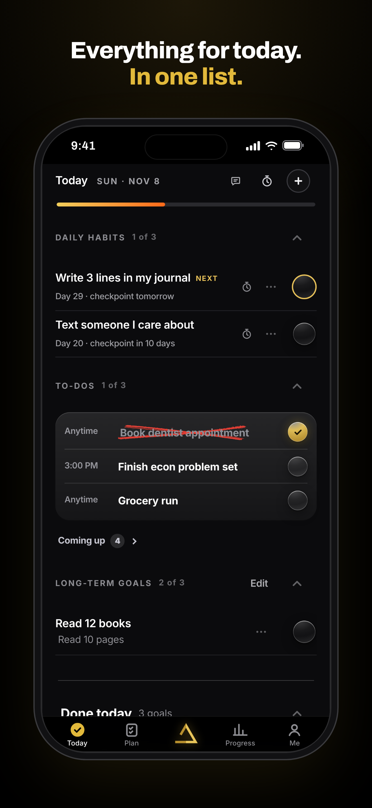
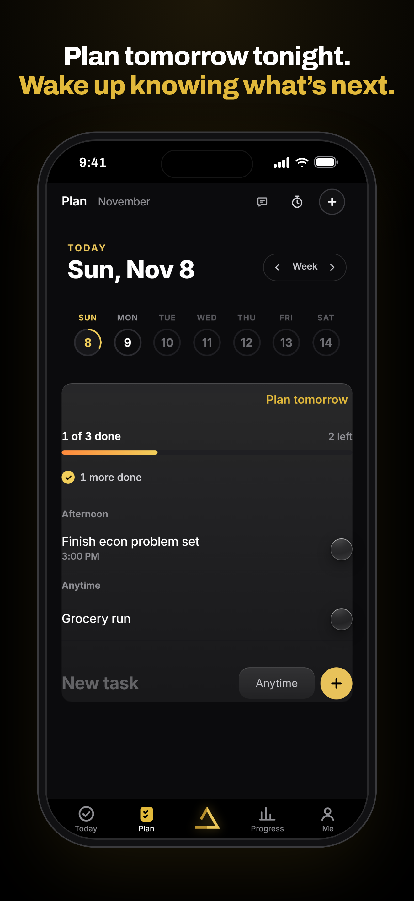
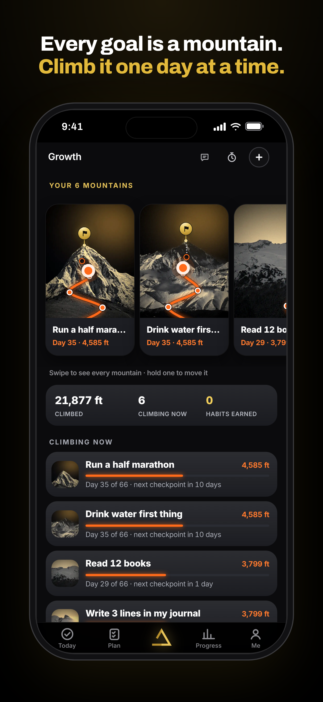
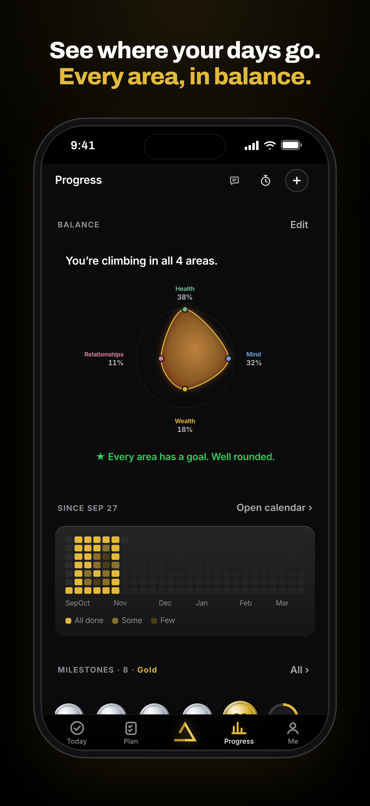
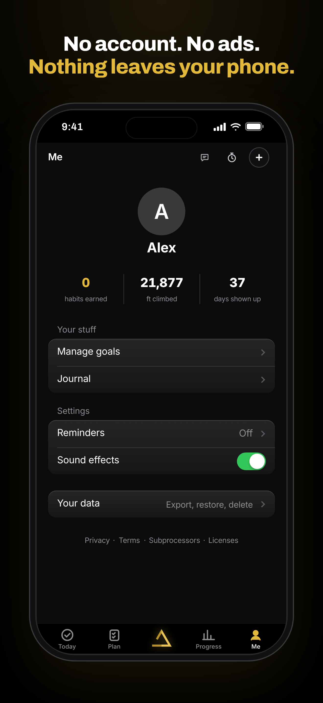

# Kaizen

An iPhone app for organizing daily habits and long-term goals. Built and published by its founder under Kaizen Grow LLC.

**Status:** in development. Preparing for TestFlight and the App Store.

<p>
  
  
  
  
  
</p>

## What it does

- **Today:** your daily habits, to-dos, and long-term goals in one list, checked off as you go.
- **Mountains:** every goal is its own mountain. Each day you check it off, you climb, with checkpoints on the way. At day 66 you reach the top and the habit is yours.
- **Plan:** plan tomorrow the night before, and schedule to-dos by time of day.
- **Progress:** a calendar of your days, a balance view across the areas of your life, and milestones.
- **Shields:** checkpoints on the climb earn shields that protect your progress.
- **Journal:** write or dictate short notes.

## Privacy

No account, no ads, no tracking. Everything stays on the phone. There is no server that stores your data.

## How it's built

Kaizen is a native SwiftUI app with a web-based interface inside it.

| Layer | What it does | Where |
|---|---|---|
| SwiftUI app shell | Launches the app, native tab bar, swipe-back navigation | `Kaizen/KaizenApp.swift`, `Kaizen/ContentView.swift` |
| Custom URL scheme (`kaizen://`) | Serves the app's pages from inside the app bundle, so it works offline | `KaizenFiles` in `ContentView.swift` |
| Native bridge | Lets the interface schedule iOS notifications and keeps an on-device backup of your data | `KaizenBridge` in `ContentView.swift` |
| Interface | Every screen, written in HTML, CSS, and JavaScript | `Kaizen/Web.bundle/` |
| Support site | Privacy policy, terms, and support pages | `site/` |

Each tab keeps its own web view in memory, so switching tabs is instant and doesn't reload.

## How I built it

I build with AI. I designed the app, wrote the feature specs, and directed the build in [Claude Code](https://claude.com/claude-code), which wrote most of the code. My job was deciding what the app should do, testing every change on my phone, catching what the AI got wrong, and sending it back until it worked.

A few things that came out of testing:
- Reworked keyboard handling several times so typing never shifts the screen.
- Cut page size from about 900 KB to under 200 KB by moving shared code into one set of files, so screens load faster.
- Replaced streak resets with shields after deciding a single missed day shouldn't erase weeks of progress.

## Project structure

```
Kaizen/
  KaizenApp.swift      App entry point
  ContentView.swift    Tabs, navigation, URL scheme, native bridge
  Web.bundle/          Every screen of the app (HTML, CSS, JS)
    core/              Shared styles and scripts
  Assets.xcassets/     App icon and launch screen
Kaizen.xcodeproj/      Xcode project
site/                  Support website and legal pages
docs/screenshots/      Screenshots used in this README
```

## Running it

Open `Kaizen.xcodeproj` in a recent version of Xcode and run it on an iPhone or the simulator. No setup or API keys are needed.

## License

Copyright © 2026 Kaizen Grow LLC. All rights reserved. The code is shared to show how the app is built. It is not licensed for reuse or redistribution. See [LICENSE](LICENSE).
